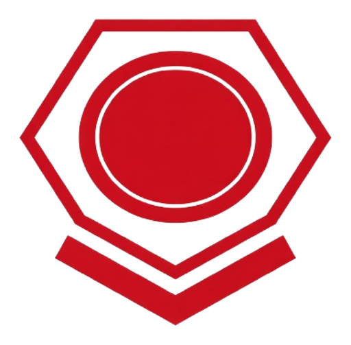
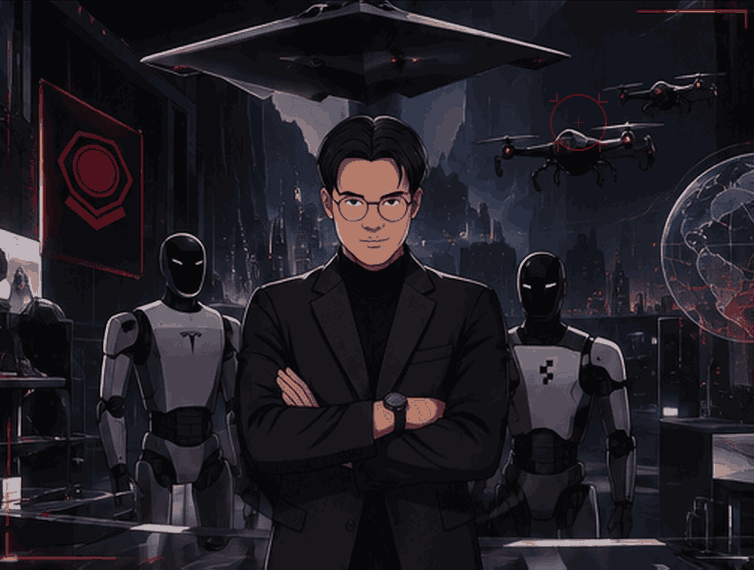

  
  <h1>JOSE TRISTAN PRABOWO</h1>
  
<strong>ROBOTICS &amp; ARTIFICIAL INTELLIGENCE ENGINEERING</strong>

  
Universitas Airlangga · Indonesia

  
<em>Engineering intelligent systems. Building for long-term impact.</em>

  

Introduction
I am a goal-oriented and persistent Robotics and Artificial Intelligence Engineering student at Universitas Airlangga, driven by a strong commitment to excellence and long-term impact. I enjoy turning complex ideas into useful systems, setting high standards, and pursuing them through disciplined execution.

I enjoy analysing data, recognising patterns, anticipating emerging trends, and translating those insights into clear strategic objectives. As a technology-driven individual, I continuously explore new developments, particularly in robotics, artificial intelligence, and blockchain.

Beyond engineering, I bring strong interpersonal, persuasion, and public-speaking skills, with experience in entrepreneurship, sales, and marketing. I enjoy working across technical and business contexts—aligning people, external resources, and execution around a shared objective. These strengths, combined with a long-term perspective, naturally draw me toward leadership and venture-building.

My long-term ambition is to create meaningful and lasting impact by building technology-led solutions and businesses that help move the world forward.
Areas of Interest
- Robotics & Autonomous Systems — intelligent machines, system integration, and real-world automation.
- Artificial Intelligence — machine learning, intelligent decision-support, and applied AI.
- Computer Vision — visual perception and image-based understanding for intelligent systems.
- Embedded Systems — hardware–software integration, prototyping, and edge devices.
- Technology & Entrepreneurship — translating technical capabilities into useful products and scalable ventures.
- Robotics & Autonomous Systems — intelligent machines, system integration, and real-world automation.
- Artificial Intelligence — machine learning, intelligent decision-support, and applied AI.
- Computer Vision — visual perception and image-based understanding for intelligent systems.
- Embedded Systems — hardware–software integration, prototyping, and edge devices.
- Technology & Entrepreneurship — translating technical capabilities into useful products and scalable ventures.

<h2>Technology Stack &amp; Ecosystem</h2>
<strong>Programming &amp; Robotics</strong>

<strong>Computer Vision &amp; Embedded Systems</strong>

<strong>Technology Ecosystem</strong>

  <strong>ROBUST THINKING · PRECISE EXECUTION · LONG-TERM IMPACT</strong>
   
  Curious by nature. Strategic by design. Driven to build.

